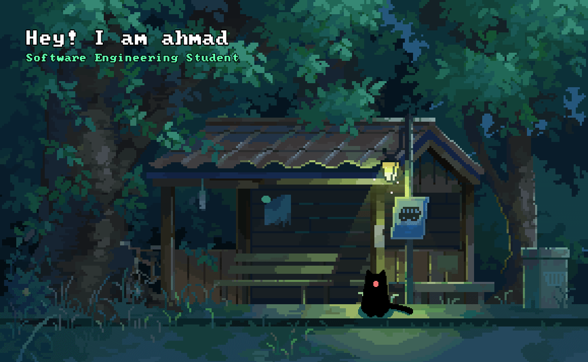

  

<h2 align="center">Hi there, I'm Ahmad! 👋</h2>

<!-- Animasi Pixel RPG -->

  

  <b>Software Engineering Student & Web Developer</b> 
  Building functional, clean, and structured web applications from backend to frontend.

---

### 👨‍💻 About Me

- 🎓 Software Engineering student & Web Developer.
- 💻 Focused on building functional web applications with **PHP**, **MySQL**, and **MVC** architecture.
- ⚡ Enjoy crafting clean backend logic and learning modern web technologies.

---

### 🛠️ Tech Stack & Tools

**Languages & Frameworks**

  
  
  
  
  

**Database & Version Control**

  
  
  
  

---

### 🚀 Featured Projects

| Project | Description | Tech Stack |
| :--- | :--- | :--- |
| **Perpus-v2** | Upgraded web-based library management system with structured collection tracking and relational database design. | `PHP`, `MySQL`, `MVC` |
| **Perpus-v1** | Initial version of the library registry system focusing on core CRUD operations and book circulation. | `PHP`, `MySQL`, `HTML/CSS` |

> 💡 *Explore the pinned repositories right below for source code and implementation details.*

---

### 🔥 Contribution Streak

  

---

### 🎮 Contribution Snake

  

---

### 📫 Let's Connect

  
  

