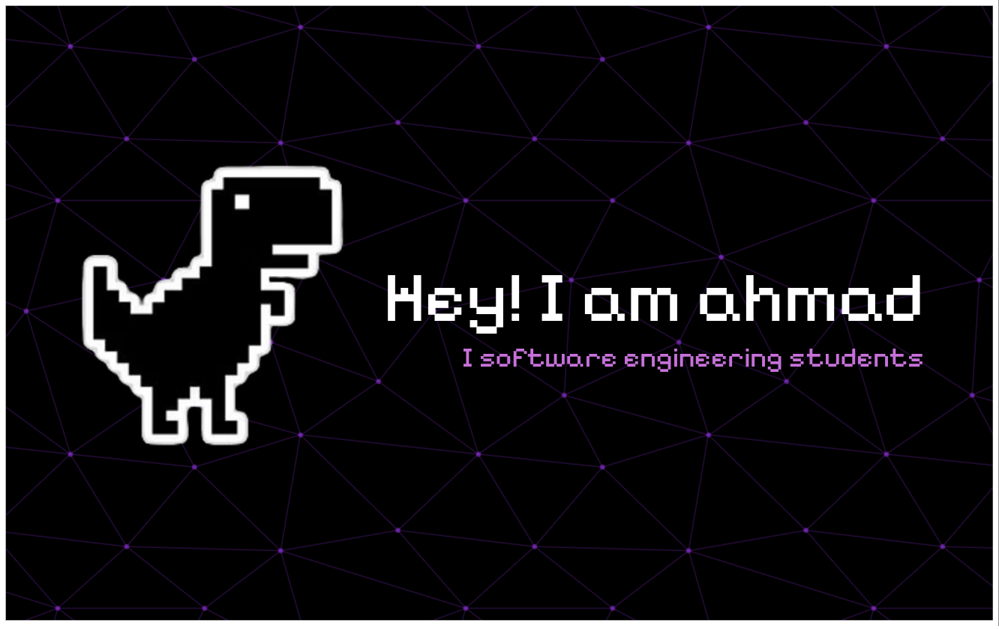

### Hi, I'm Ahmad! 👋

I am a software engineering student and Web Developer focused on building functional applications using PHP, MySQL, and the MVC architecture.

- 🔭 Currently focusing on developing practical web applications and preparing for practical evaluations.
- ⚡ Passionate about writing clean backend logic and exploring modern web technologies.

---

### 🛠️ Tech Stack & Tools:

  
  
  
  
  
  

---

### 🚀 Highlight Projects:
> *Check out my pinned repositories below for live project displays.*

- **Perpus-v1 & Perpus-v2:** A web-based library management system built with PHP and MySQL.

---

